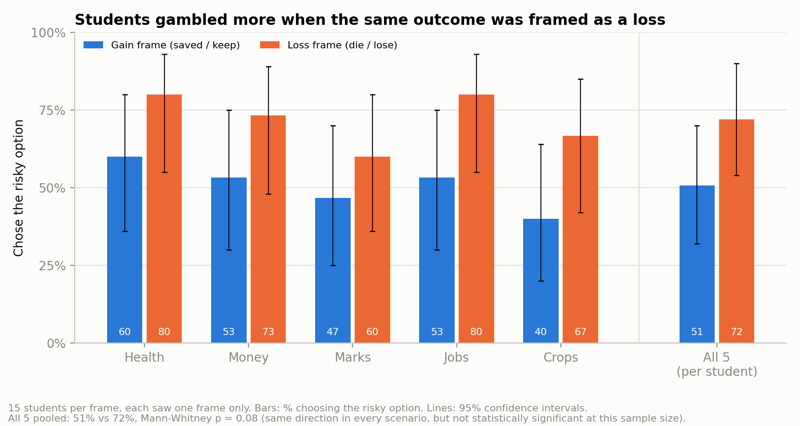

# Same Facts, Different Frames

Do people choose differently when the same outcome is described as a gain instead of a loss? And do AI models fall for the same trick?

This is my replication of a classic experiment by Tversky & Kahneman (1981), the "Asian disease" problem. They found that people tend to play it safe when options are described as lives *saved*, but take a gamble when the exact same options are described as lives *lost*. I wanted to see whether students today show the same pattern, and then test whether today's AI models do too.

## What I did

### Students

- I wrote **5 decision scenarios** about health, money, exam marks, jobs and crops. In each one, the sure option and the risky option have the **same expected value**. For example, "200 of 600 people are definitely saved" vs "a 1 in 3 chance all 600 are saved". So any preference between them comes from how the choice is described, not from the maths.
- I wrote each scenario in two versions. The **gain frame** uses "saved / keep" and the **loss frame** uses "die / lose". The numbers are identical; only the words change. The exact wording is in [`src/items.py`](src/items.py).
- I made **two Google Forms**, one per frame, and shared them with students on 31 October 2026. Each student saw only one frame, so nobody could compare the two versions.
- **Selection rule, fixed before I looked at any answers:** use the first 15 complete responses per form, in the order they were submitted. The gain form got 24 responses and the loss form got 15, so the last 9 gain responses are in the data but not in the analysis.
- The students were aged 16–22. The forms didn't collect names or emails.

### AI models (in progress)

- I'll ask 6 models the same 5 questions, word for word: a flagship and a small model from each of Anthropic, OpenAI and Google.
- Each question will be asked 30 times per frame, in two ways: answer directly, or think step by step first.
- The order of options A and B is swapped on half the runs, so a model can't just favour "A".
- I'll turn off the models' built-in reasoning where the API allows, so the prompt is the only difference between the two modes.

The code for this part is written and tested on fake models. The real runs haven't been done yet.

## Results so far: students



| Scenario | Gain frame: chose risky | Loss frame: chose risky | Gap |
|---|---|---|---|
| Health | 9/15 (60%) | 12/15 (80%) | +20 points |
| Money | 8/15 (53%) | 11/15 (73%) | +20 |
| Exam marks | 7/15 (47%) | 9/15 (60%) | +13 |
| Jobs | 8/15 (53%) | 12/15 (80%) | +27 |
| Crops | 6/15 (40%) | 10/15 (67%) | +27 |
| **All 5** | **38/75 (51%)** | **54/75 (72%)** | **+21** |

- **In every scenario**, students took the gamble more often when the outcome was described as a loss. That is the same direction Tversky & Kahneman found.
- 12 of the 15 loss-frame students chose the risky option on most questions (3 or more out of 5), compared with 7 of 15 in the gain frame.
- **But this isn't statistically significant.** Comparing each student's score out of 5 between the two groups gives p = 0.08 (Mann-Whitney test), and no single scenario is significant on its own (Fisher's exact test, p = 0.25–0.72). With only 15 students per group, a gap this size could still happen by chance. So the result is *consistent with* the framing effect, but too small to confirm it.
- I treated each student as one data point in the pooled result, because their 5 answers aren't independent. Counting all 75 answers as separate would make the result look more certain than it is.

Full tables: [`results/tables/students_by_scenario.csv`](results/tables/students_by_scenario.csv) and [`results/tables/students_per_student.csv`](results/tables/students_per_student.csv).

**Data check:** two gain-frame responses are identical and were submitted in the same second, so it could be a double submission. Dropping one and using the 16th response instead gives exactly the same result (38/75, p = 0.08).

## Limitations

- 15 students per frame, from one group, so the sample is small.
- The choices were hypothetical, with no real stakes.
- AI models change over time. The AI results will apply only to the model versions and dates I record.

## How to run it

```
python3 -m venv .venv && source .venv/bin/activate
pip install -r requirements.txt
python src/analyse_students.py              # student statistics -> results/tables/
python src/make_charts.py --students-only   # student chart -> results/figures/

# AI side (needs API keys)
cp .env.example .env                        # then add your keys
python src/run_models.py --dry-run          # check prompts and call counts first
python src/run_models.py
python src/score.py
python src/analyse_models.py
python src/make_charts.py
```

Add `--mock` to any AI-side step to test the pipeline with fake models, for free.

## Files

| File | What it does |
|---|---|
| `data/students/gain.csv`, `loss.csv` | Raw Google Forms exports (timestamp, 5 answers, age) |
| `src/items.py` | The 5 questions in both frames, and how a prompt is built |
| `src/analyse_students.py` | Student statistics; checks the counts match the reported result |
| `src/run_models.py` | Sends every prompt to every model and logs every reply |
| `src/score.py` | Reads each reply's answer and turns it into sure / risky |
| `src/analyse_models.py` | Model statistics |
| `src/make_charts.py` | The charts |

## Credits

Study design, survey questions, data collection and interpretation: Ranveer. I used an AI coding assistant to help write and check the analysis code. Every number above can be reproduced from the raw data with the commands in "How to run it".

Original experiment: Tversky, A., & Kahneman, D. (1981). The framing of decisions and the psychology of choice. *Science*, 211(4481), 453–458.
